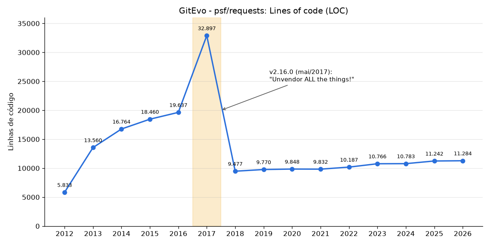

# Explorando evolução de código

Neste exercício, iremos explorar a evolução de código em sistemas reais.

Iremos utilizar a ferramenta [GitEvo](https://github.com/andrehora/gitevo).
Essa ferramenta analisa a evolução de código em repositórios Git nas linguagens Python, JavaScript, TypeScript e Java, e gera relatórios `HTML` como [este](https://andrehora.github.io/gitevo-examples/python/pandas.html).

Mais exemplos de relatórios podem ser podem ser encontrados em https://github.com/andrehora/gitevo-examples.

# Passo 1: Selecionar repositório a ser analisado

Selecione um repositório relevante na linguagem de sua preferência (Python, JavaScript, TypeScript ou Java).
Você pode encontrar projetos interessantes nos links abaixo:

- Python: https://github.com/topics/python?l=python
- JavaScript: https://github.com/topics/javascript?l=javascript
- TypeScript: https://github.com/topics/typescript?l=typescript
- Java: https://github.com/topics/java?l=java

# Passo 2: Instalar e rodar a ferramenta GitEvo

> [!NOTE]
> Antes de instalar a ferramenta, é recomendado criar e ativar um [ambiente virtual Python](https://packaging.python.org/en/latest/guides/installing-using-pip-and-virtual-environments/#create-and-use-virtual-environments).

Instale a ferramenta [GitEvo](https://github.com/andrehora/gitevo) com o comando:

```
$ pip install gitevo
```

Execute a ferramenta no repositório selecionado utilizando o comando abaixo (ajuste conforme a linguagem do repositório).
Substitua `<git_url>` pela URL do repositório que será analisado:

```shell
# Python
$ gitevo -r python <git_url>

# JavaScript
$ gitevo -r javascript <git_url>

# TypeScript
$ gitevo -r typescript <git_url>

# Java
$ gitevo -r java <git_url>
```

Por exemplo, para analisar o projeto Flask escrito em Python:

```
$ gitevo -r python https://github.com/pallets/flask
```

> [!NOTE]
> Essa etapa pode demorar alguns minutos pois o projeto será clonado e analisado localmente.

# Passo 3: Explorar o relatório de evolução de código

Após executar a ferramenta [GitEvo](https://github.com/andrehora/gitevo), é gerado um relatório `HTML` contendo diversos gráficos sobre a evolução do código.

Abra o relatório `HTML` e observe com atenção os gráficos.

# Passo 4: Explicar um gráfico de evolução de código

Selecione um dos gráficos de evolução e explique-o com suas palavras.
Por exemplo, você pode:

- Detalhar a evolução ao longo do tempo
- Detalhar se as curvas estão de acordo com boas práticas
- Explicar grandes alterações nas curvas
- Explorar a documentação do repositório em busca de explicações para grandes alterações
- etc.

Seja criativo!

# Instruções para o exercício

1. Crie um `fork` deste repositório (mais informações sobre forks [aqui](https://docs.github.com/pt/pull-requests/collaborating-with-pull-requests/working-with-forks/fork-a-repo)).
2. Adicione o relatório `HTML` no seu fork.
3. No Moodle, submeta apenas a URL do seu `fork`.

Responda às questões abaixo diretamente neste arquivo `README.md` do seu fork:

1. Repositório selecionado: https://github.com/psf/requests

   Relatório gerado: [`report_requests.html`](report_requests.html) (dados brutos em [`report_requests.csv`](report_requests.csv)).
   Comando utilizado (com histórico desde 2012, para capturar mais da evolução do projeto):

   ```
   $ gitevo -r python -f 2012 https://github.com/psf/requests
   ```

2. Gráfico selecionado: **Lines of code (LOC)**

   

3. Explicação:

   O gráfico mostra o total de linhas de código Python do repositório `requests`, uma das bibliotecas HTTP mais usadas em Python, em um snapshot por ano (o GitEvo usa o último commit antes do início de cada ano; então o ponto "2017" é o estado do código no fim de 2016).
   A curva tem três fases bem claras.

   **Fase 1: crescimento (2012–2016, 5.833 → 19.637 LOC).**
   O projeto cresce rápido no começo (mais que dobra entre 2012 e 2013) e depois desacelera.
   Só que boa parte desse código não era do `requests`: o projeto fazia *vendoring* das suas dependências, ou seja, guardava uma cópia do `urllib3` e do `chardet` dentro de `requests/packages/`.
   Assim, o LOC acompanhava o crescimento dessas bibliotecas, e não só o do próprio `requests`.

   **Fase 2: o pico (2017, 32.897 LOC).**
   De um ano para o outro o LOC aumenta cerca de 13 mil linhas e o número de arquivos `.py` vai de 84 para 106.
   Segundo o histórico do Git, isso não foi uma funcionalidade nova: em 14/10/2016 entrou o commit *"Vendor idna v2.1"*, que copiou também a biblioteca `idna` para dentro de `requests/packages/`.
   Só o arquivo `idna/uts46data.py` (uma tabela Unicode gerada automaticamente) tem cerca de 180 KB.
   O gráfico *Data structures* do mesmo relatório confirma isso: o número de tuplas pula de 439 para **9.037** e depois volta para 471.
   No fim de 2016, 76 dos arquivos Python do repositório (38 do `chardet`, 30 do `urllib3`, 7 do `idna` e mais 1) eram código de terceiros.

   **Fase 3: a queda e a estabilidade (2018–2026, ~9,5 mil → 11,3 mil LOC).**
   Em maio de 2017 saiu a versão **2.16.0**, cuja única entrada no `HISTORY` é *"Unvendor ALL the things!"*.
   As cópias embutidas foram removidas, e `urllib3`, `chardet` e `idna` passaram a ser dependências normais, instaladas pelo `pip`.
   O LOC cai cerca de 71% (32.897 → 9.477) e os arquivos vão de 106 para 35.
   Para manter compatibilidade com quem importava `requests.packages.urllib3`, ficou só um *shim* pequeno (`requests/packages.py`).
   Desde então a curva é quase plana, com crescimento de cerca de 1,9% ao ano, o que combina com um projeto maduro, que hoje está mais em manutenção do que ganhando funcionalidades novas.
   Nesse período os aumentos vêm de melhorias pontuais e de testes (os arquivos de teste passam de 1 para 7 em 2017 e chegam a 10 em 2025), e não de funcionalidades novas.

   **Boas práticas.**
   A queda no gráfico é uma melhoria e não perda de código.
   Copiar dependências para dentro do projeto dificulta atualizações de segurança (um bug no `urllib3` exigia uma nova versão do `requests`), gera conflitos com distribuições Linux que proíbem código duplicado e infla métricas como o LOC.
   Depois do *unvendoring*, o LOC passou a medir só o código que o time do `requests` mantém de fato.
   O gráfico também mostra um cuidado ao usar métricas de tamanho: sem olhar o histórico, alguém poderia achar que o projeto perdeu dois terços do código em 2017, quando o código próprio continuou praticamente o mesmo.


